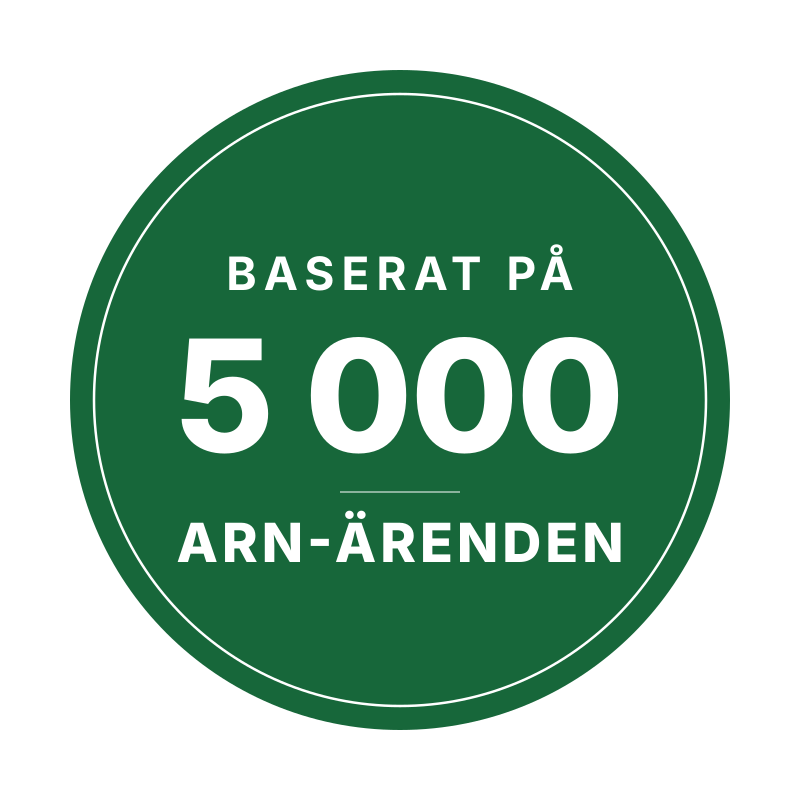

# ARN-badge – "Baserat på 5 000 ARN-ärenden"

Statisk badge, grön med vit text.

- `badge-5000.svg` – vektor, skarp i alla storlekar. Rekommenderas.
- `badge-5000.png` – 1600 × 1600 px med genomskinlig bakgrund, om något system inte tar SVG.

```html

```

## Ändra
- **Färg:** grönt är `#17673a` (fill på den stora cirkeln). Texten och ringen är `#ffffff`.
- **Text:** all text är omgjord till vektorformer (typsnitt Inter ExtraBold), så filen ser
  likadan ut i alla program och kräver inget typsnitt. Det betyder också att texten inte
  kan redigeras direkt i filen – säg till om siffran eller orden behöver ändras.
